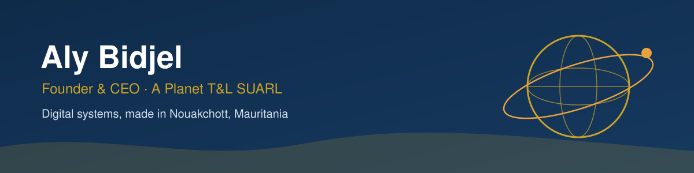

  

  
  
  
  

## Hi, I'm Aly 👋

I'm the founder and CEO of **A Planet T&L SUARL**, a digital transformation company in Nouakchott, Mauritania. We help public institutions, businesses and organisations run on modern systems: ERP and CRM, document management, websites and mobile apps, and automation.

I also build **Khayr Al-Ard**, an agritech app that connects farmers, herders, neighbourhood shops and buyers directly.

## 🌍 What A Planet does

| Service | What we deliver |
| --- | --- |
| 🧾 **Odoo ERP & CRM** | Sales, invoicing, CRM, projects and HR on Odoo, set up and supported locally |
| 🗂️ **Document management** | Mayan EDMS: digital archives, workflows and secure remote access |
| 📱 **Web & mobile apps** | Websites, admin panels and mobile apps with local payment (Bankily, Sedad) |
| 🤖 **Automation & AI assistants** | Process automation, WhatsApp workflows and AI assistants |
| 🧭 **Consulting & training** | Digital transformation planning, project management and IT training |

## ✅ Delivered work

| Client | Work | Status |
| --- | --- | --- |
| **SAMU Mauritanie** (national emergency medical service) | Website [samu.mr](https://samu.mr) and its administration panel | Delivered · in maintenance |
| **IPFRS** (teacher-training institute) | Odoo ERP system | Delivered October 2026 |
| **Khayr Al-Ard** (our own product) | Agritech app in Arabic, French and English, with a Hassaniya voice advisor | Google Play testing · Nov 2026 |
| **A Planet** (our own operations) | Odoo 19, Mayan EDMS and daily automated backups | Running in-house |

## 🌾 Khayr Al-Ard

> *«من رحم الأرض إلى قلب السوق»* (from the heart of the land to the heart of the market)

- Free for farmers and herders; revenue comes from buyers, exporters and partner organisations
- Account types for farmers, herders, shops, butchers, fruit and vegetable sellers, and exporters
- Neighbourhood delivery, seller map, digital receipts, and weather and satellite readings for plots
- Incubated in **UNDP timbuktoo Launchpad, Cohort 1**
- 🔗 [khayr-alard.com](https://khayr-alard.com)

## 🛠️ What I build with

## 🏛️ Registrations & communities

| | |
| --- | --- |
| **UNGM** (United Nations Global Marketplace) | Vendor 1223963 |
| **SAM.gov** (US federal vendors) | UEI Q5WFES9AY7E4 · active |
| **NCAGE** (NATO) | STRG2 |
| **D-U-N-S** | 850422625 |
| **UN Universal DPI Safeguards** | Community of Practice member, 2026–2027 |
| **UNDP timbuktoo** | Launchpad, Cohort 1 (Khayr Al-Ard) |

## 👤 About me

- 🎓 Teaching qualification in English (ENS Nouakchott) and BA in English and Spanish (University of Nouakchott)
- 💼 Seven years of work in Dubai (2017–2023) in customer service for DEWA and RTA, then Teleperformance (Philips) and real estate, before founding A Planet in 2024
- 📜 Certificates: Python (Sololearn), Blockchain (Great Learning), Duolingo English Test
- ✍️ Author of a novel and an essay (2024)
- 🗣️ Arabic and Hassaniya (native), English (fluent), Spanish (intermediate)

## 📫 Contact

**A Planet T&L SUARL** · Nouakchott, Mauritania
📧 [ali@aplanet-mauritania.com](mailto:ali@aplanet-mauritania.com) · 📞 +222 33 44 51 25 · 🌐 [aplanet-mauritania.com](https://www.aplanet-mauritania.com)
